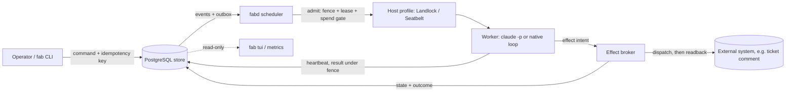

# Architecture

This page describes the current core. The target (tenant-aware kernel, node agent, adapters, capability broker, message bus, gateway) is in [adr/0001-kernel-scope.md](adr/0001-kernel-scope.md) and [status-and-roadmap.md](status-and-roadmap.md).

Agent Fabric is one Go binary (`fab`) over one PostgreSQL database. `fab daemon` (fabd) is the only writer of mission state. Workers are separate processes that fabd launches under a host profile.

## Components

| Component | Package | Job |
|---|---|---|
| State machine | `internal/domain`, `internal/reducer` | Pure functions: apply a command to a mission, return events. Three independent version counters and four state dimensions. A separate invariant oracle checks every trace. |
| Store | `internal/store` | PostgreSQL authority. One transaction per command, replay-stable under an idempotency key, gap-free per-mission event sequence, transactional outbox, attempts with database-time leases and fences. numbered migrations (latest 0038). |
| Effect broker | `internal/effects` | Moves outside-world actions through `INTENT -> DISPATCHED -> CONFIRMED / FAILED_DEFINITE / UNKNOWN`. An `UNKNOWN` outcome is settled by reading the target system back, never by guessing. |
| Scheduler | `internal/sched`, `cmd/fab` | Admission, jobs, waits, event-driven relaunch, spend and dispatch gates. |
| Host profiles | `internal/host` | Linux (systemd user unit, cgroup inventory, Landlock) and macOS (own session, Seatbelt, inventory by token and inherited descriptor). Each profile has negative controls that must pass before it advertises a boundary. |
| Providers | `internal/provider/claude`, `internal/native` | `claude-code` workers launched from a policy grant, or the native `anthropic-api` loop with budget holds. |
| Review gate | `internal/reviewgate` | Optional durable human review of every native tool call (`FABRIC_REVIEW_GATE=1`). |
| Operator surface | `cmd/fab`, `internal/tui`, `internal/metrics` | CLI, read-only terminal view, Prometheus text metrics. |
| Ladder | `internal/ladder` | Pure model-ladder function with tests. Not yet called by the daemon (see [status-and-roadmap.md](status-and-roadmap.md)). |

## Data flow

1. An operator or job creates a mission. The store records a command and its events in one transaction.
2. The scheduler admits a mission when its dependencies, spend caps and dispatch limits allow. Final admission rechecks fence, lease and intent revision against the database clock.
3. The host profile confines the worker. The worker environment is an allow-list built by fabric.
4. The worker reports progress and requests effects. A stale attempt cannot write: the fence rejects it.
5. The broker records an intent, dispatches under an advisory lock, and settles the outcome. If the outcome is unknown, readback decides, and a conflict ends in `QUARANTINED` for an operator.
6. A mission is done only after `fab live-test` records a receipt for the deployed commit and no effect is unsettled.

## Principles

- Deterministic first: models propose, a pure reducer and database constraints decide.
- Fail closed: an unreadable state, unsettled effect or database error blocks progress instead of assuming success.
- Append-only audit: events, commands and effect resolutions refuse UPDATE and DELETE.
- Authority proof: an action is allowed when it carries verifiable proof that an authorized principal sanctioned it. Today approval is a caller option and the approver is a text field; making it proof-based is planned (goodqa#15135).

## Run, test, deploy

- Build: `CGO_ENABLED=0 go build -buildvcs=true -o fab ./cmd/fab` (Go 1.22; dependencies are `pgx/v5` and `x/sys`).
- Test: `go test ./...` for the pure packages; set `FABRIC_TEST_DSN` to a disposable database for the store tests. `python3 -I tools/mutants/run.py --repo . --out mutants.tsv` runs the must-fail mutants.
- Deploy: follow "Deploying" in the [README](../README.md): back up, build from a clean checkout, stop fabd, `fab migrate`, `fab db roles`, smoke test with `fab version` and `fab metrics`.

See also [review-gates.md](review-gates.md), [threat-model.md](threat-model.md) and [sota/](sota/README.md).
